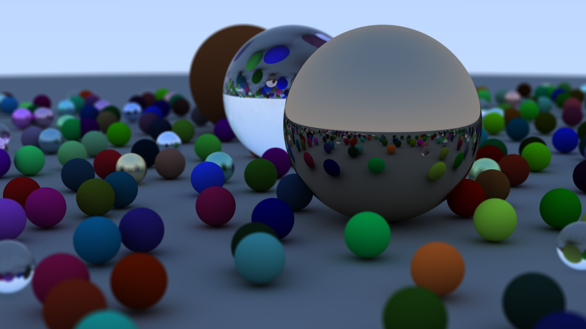

# Ray Tracing in One Weekend

An implementation of Peter Shirley’s [_Ray Tracing in One Weekend_](https://raytracing.github.io/books/RayTracingInOneWeekend.html), built from scratch in C++.

---

## 🖼️ Latest Output

  

